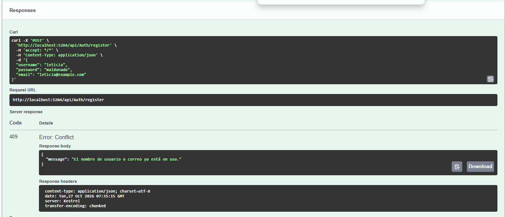
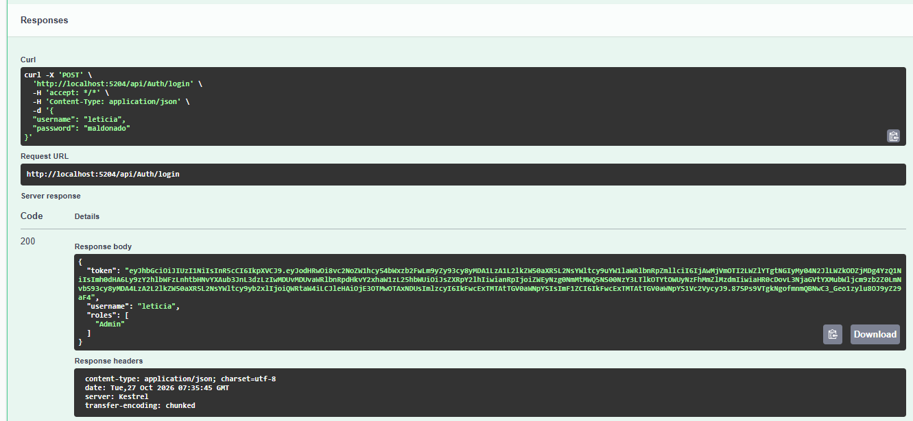
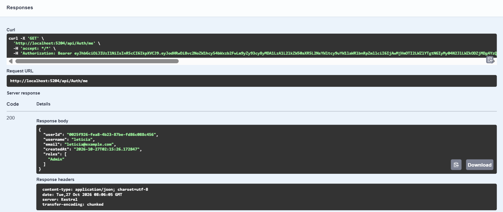
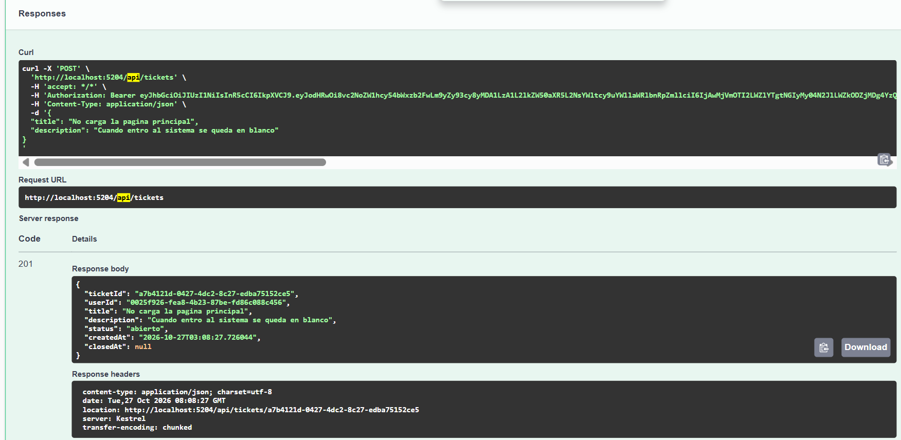
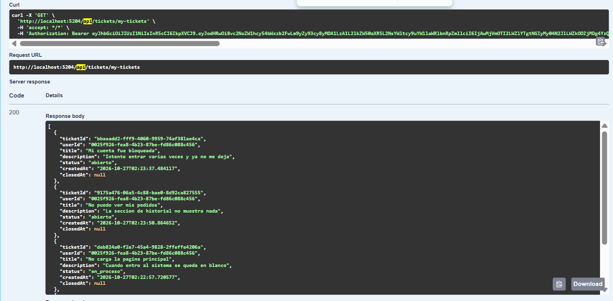
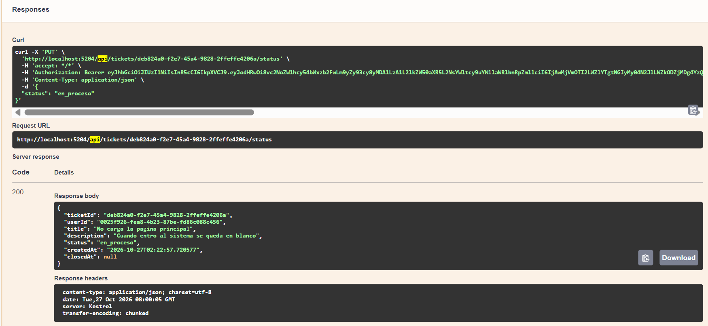
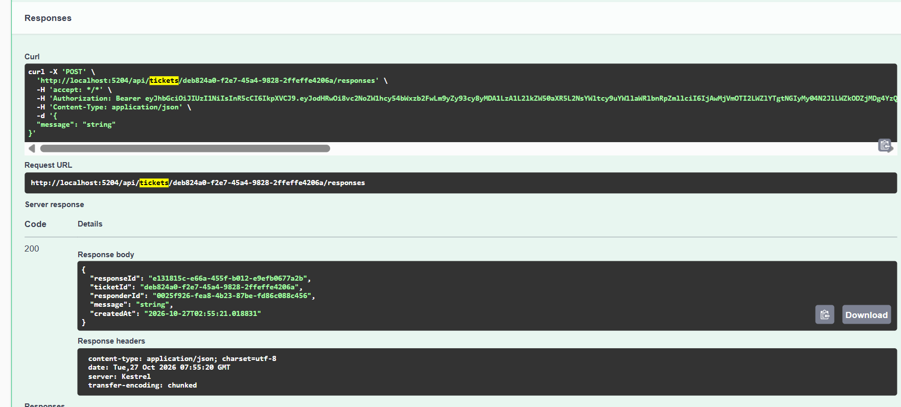
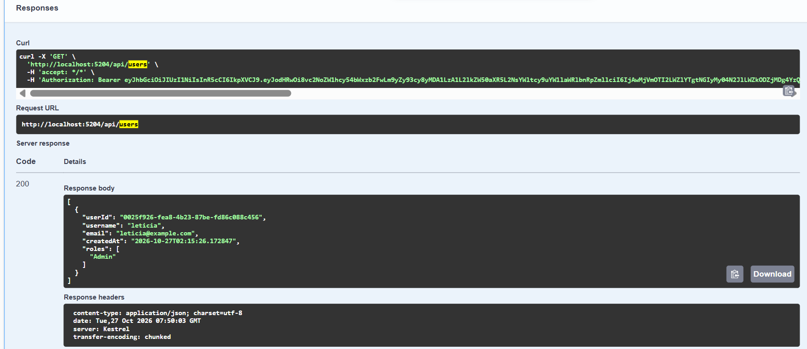

# AppLS10 — API de Ticketera

API REST construida con ASP.NET Core 10 usando Clean Architecture. El proyecto es una ticketera donde los usuarios pueden abrir tickets de soporte y los administradores pueden gestionarlos y responderlos.

---

## Arquitectura

El proyecto está dividido en 4 capas:

```
AppLS10.domain          → Entidades y contratos (interfaces)
AppLS10.application     → Casos de uso, DTOs y mapeos
AppLS10.infrastructure  → EF Core, repositorios, JWT, Unit of Work
AppLS10.api             → Controllers, configuración y Swagger
```

La dependencia siempre va hacia adentro: `api → application → domain ← infrastructure`.

---

## Qué implementa

### ✅ Arquitectura limpia (Clean Architecture)
Cada capa tiene su responsabilidad bien definida. Domain no depende de nada externo, application solo de domain, y infrastructure implementa los contratos definidos en domain.

### ✅ Swagger
Configurado con autenticación Bearer JWT. Al iniciar el proyecto en desarrollo, Swagger está disponible en `/swagger`.

### ✅ JWT (JSON Web Tokens)
- Al hacer login se devuelve un token firmado con HMAC-SHA256
- El token incluye el `userId`, `username` y `roles` como claims
- Los endpoints protegidos validan issuer, audience, firma y expiración

### ✅ Encriptación de contraseñas
Las contraseñas se guardan hasheadas usando `BCrypt` — nunca en texto plano.

### ✅ Patrón Repository
Implementado con una clase genérica `Repository<T>` que cubre las operaciones base (GetById, GetAll, Add, Update, Remove). Cada entidad tiene su propio repositorio que extiende el genérico y agrega queries específicas.

```
IRepository<T>          → contrato genérico (domain)
Repository<T>           → implementación base (infrastructure)
UserRepository          → agrega GetByUsername, GetWithRoles
TicketRepository        → agrega GetByUserId
ResponseRepository      → agrega GetByTicketId
```

### ✅ Unit of Work
`IUnitOfWork` agrupa todos los repositorios bajo una sola transacción. Los casos de uso reciben el UoW por inyección de dependencias y llaman `SaveChangesAsync()` al final, garantizando consistencia.

---

## Endpoints

### Auth
| Método | Ruta | Acceso | Descripción |
|--------|------|--------|-------------|
| POST | `/api/auth/register` | Público | Registrar nuevo usuario |
| POST | `/api/auth/login` | Público | Login, devuelve JWT |
| GET | `/api/auth/me` | Autenticado | Datos del usuario actual |

### Tickets
| Método | Ruta | Acceso | Descripción |
|--------|------|--------|-------------|
| POST | `/api/tickets` | User / Admin | Crear ticket |
| GET | `/api/tickets` | Admin | Listar todos los tickets |
| GET | `/api/tickets/my-tickets` | User / Admin | Mis tickets |
| GET | `/api/tickets/{id}` | Admin | Ticket por ID |
| PUT | `/api/tickets/{id}/status` | Admin | Cambiar estado |
| DELETE | `/api/tickets/{id}` | Admin | Eliminar ticket |

### Respuestas
| Método | Ruta | Acceso | Descripción |
|--------|------|--------|-------------|
| POST | `/api/responses/{ticketId}` | Admin | Agregar respuesta a ticket |
| GET | `/api/responses/{ticketId}` | Autenticado | Ver respuestas de un ticket |

### Usuarios y Roles
| Método | Ruta | Acceso | Descripción |
|--------|------|--------|-------------|
| GET | `/api/users` | Admin | Listar usuarios |
| GET | `/api/users/{id}` | Admin | Usuario por ID |
| GET | `/api/roles` | Admin | Listar roles |

---

## Cómo probar en Swagger

1. Iniciar el proyecto (`AppLS10.api`)
2. Abrir `https://localhost:{puerto}/swagger`
3. Registrar un usuario con `POST /api/auth/register`
4. Hacer login con `POST /api/auth/login` y copiar el token
5. Clic en el botón **Authorize** (arriba a la derecha) y pegar el token
6. Ya puedes usar los endpoints protegidos

---

## Base de datos

PostgreSQL. La cadena de conexión va en `appsettings.json`:

```json
"ConnectionStrings": {
  "DefaultConnection": "Host=localhost;Port=5432;Database=ls9;Username=postgres;Password=root"
}
```

Las migraciones están generadas con EF Core. Para aplicarlas:

```bash
dotnet ef database update --project AppLS10.infrastructure --startup-project AppLS10.api
```

---

## Roles

El sistema tiene dos roles:
- **Admin** — acceso total
- **User** — puede crear tickets y ver los suyos

Al registrarse, el usuario recibe el rol `User` por defecto.

---

## Pruebas en Swagger

### Registro de usuario
**POST** `/api/auth/register`
```json
{
  "username": "leticia",
  "password": "123456",
  "email": "leticia@correo.com"
}
```
**Response 200:**
```json
{
  "userId": "a1b2c3d4-...",
  "username": "leticia",
  "email": "leticia@correo.com",
  "createdAt": "2026-10-27T06:00:00Z",
  "roles": ["User"]
}
```

---

### Login
**POST** `/api/auth/login`
```json
{
  "username": "leticia",
  "password": "123456"
}
```
**Response 200:**
```json
{
  "token": "eyJhbGciOiJIUzI1NiIsInR5cCI6IkpXVCJ9...",
  "username": "leticia",
  "roles": ["User"]
}
```

> El token se pega en el botón **Authorize** de Swagger para acceder a los endpoints protegidos.

---

### Crear ticket (requiere token)
**POST** `/api/tickets`
```json
{
  "title": "No puedo iniciar sesión",
  "description": "Me aparece error 401 al intentar entrar al sistema"
}
```
**Response 201:**
```json
{
  "ticketId": "f7e6d5c4-...",
  "userId": "a1b2c3d4-...",
  "title": "No puedo iniciar sesión",
  "description": "Me aparece error 401 al intentar entrar al sistema",
  "status": "abierto",
  "createdAt": "2026-10-27T06:05:00Z",
  "closedAt": null
}
```

---

### Cambiar estado de ticket (solo Admin)
**PUT** `/api/tickets/{id}/status`
```json
{
  "status": "en_proceso"
}
```
**Response 200:**
```json
{
  "ticketId": "f7e6d5c4-...",
  "status": "en_proceso",
  ...
}
```

---

### Agregar respuesta a un ticket (solo Admin)
**POST** `/api/responses/{ticketId}`
```json
{
  "message": "Revisamos tu caso, en breve lo solucionamos."
}
```
**Response 201:**
```json
{
  "responseId": "c1d2e3f4-...",
  "ticketId": "f7e6d5c4-...",
  "responderId": "admin-uuid-...",
  "message": "Revisamos tu caso, en breve lo solucionamos.",
  "createdAt": "2026-10-27T06:10:00Z"
}
```

---

## Stack

- ASP.NET Core 10
- Entity Framework Core 10 + Npgsql (PostgreSQL)
- JWT Bearer Authentication
- BCrypt para hashing de contraseñas
- Swagger / OpenAPI

---

## Evidencias de Pruebas en Swagger

### 1. Registro de Usuario (`POST /api/Auth/register`)


### 2. Autenticación y Obtención de Token JWT (`POST /api/Auth/login`)


### 3. Información del Usuario Autenticado (`GET /api/Auth/me`)


### 4. Creación de Ticket (`POST /api/tickets`)


### 5. Obtener Mis Tickets (`GET /api/tickets/my-tickets`)


### 6. Actualización de Estado de Ticket (`PUT /api/tickets/{id}/status`)


### 7. Enviar Respuesta a un Ticket (`POST /api/tickets/{ticketId}/responses`)


### 8. Listar Usuarios (`GET /api/users`)

